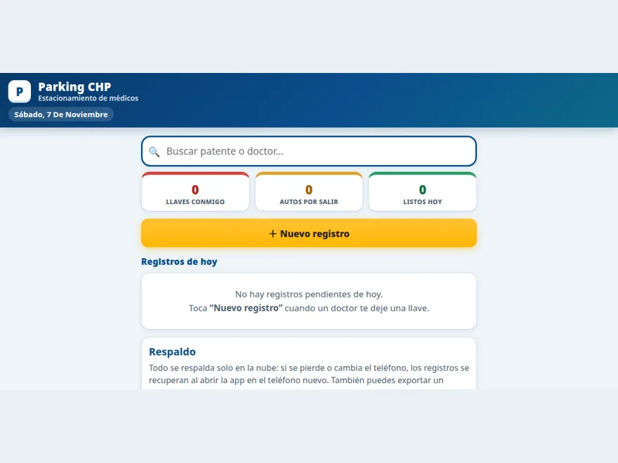

# Parking CHP

A daily operations PWA for a parking business serving doctors at a medical center in Chile. It replaced the paper logbook used to track car keys: who dropped off a key, which cars are ready, and what is still pending at the end of the day.

**Live app:** https://ramiiron.github.io/parking-chp/



## Features

- Fast new entry when a doctor hands over a key — built for one-handed use at the counter
- Live counters: keys in custody, cars waiting to leave, cars completed today
- Search by license plate or doctor name
- Automatic cloud backup: if the phone is lost or replaced, records are restored by opening the app on the new phone
- Manual export/import as a second safety net
- Offline-first: records are kept on the phone and backed up when the internet returns
- The business's real paper records were migrated into the app at launch

## Tech

- Vanilla JavaScript, HTML, and CSS — no framework
- Firebase for automatic cloud backup
- Progressive Web App: installable, works offline
- Hosted on GitHub Pages

## Run locally

```bash
git clone https://github.com/ramiiron/parking-chp.git
cd parking-chp
python3 -m http.server 8000
# Open http://localhost:8000
```

---

Built and maintained by [Ramiro Bugueño](https://github.com/ramiiron) — IT support specialist & systems administration student.
